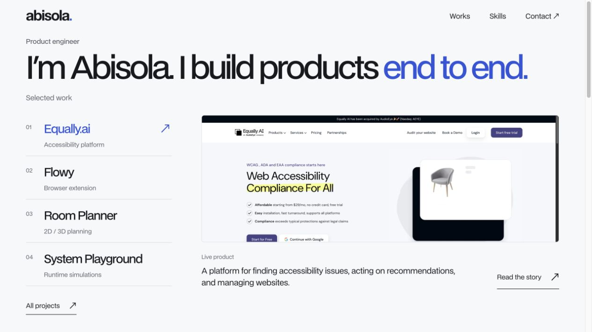
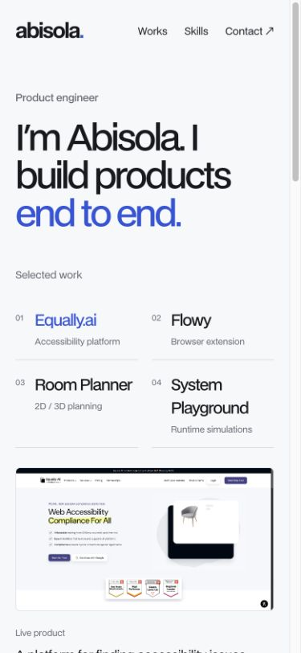

# Verification, 14 October 2026

## Passed locally

- `npm run check`: strict root TypeScript, ESLint (including Studio source), 7 content/rendering tests, production build, and 4 artifact checks.
- `npm run typecheck --prefix studio` and Studio production build. The build used a syntax-only `verification` project identifier; this verifies compilation, not an account connection.
- Generated HTML for the homepage, collection, nine project routes, and 404. The 11 published routes have individual metadata and hydrate from the exact same snapshot. Sitemap excludes 404 and unpublished records.
- Tests cover deterministic ordering, featured selection, direct slugs, approved Equally copy/order, optional fields, empty collections/notes, draft/release exclusion, unsafe links, script-safe snapshot serialization, CMS failures, and mocked publish/update/unpublish changes.
- A connected build with missing identifiers fails before overwriting rendered HTML. Public JS contains no Studio renderer or token variable names. Connected reads cannot silently fall back to fixtures.
- Production preview HTTP: `/`, `/projects`, `/projects/equally-ai`, and `/projects/flowy` returned 200; `/projects/unknown` and `/unknown-route` returned 404. All returned useful HTML headings without requiring client execution.
- Browser review of homepage, collection, Equally, and Flowy. Project selection changes the image, summary, status, and route. Arrow-key selection and Home worked; tab state/focus followed selection. Flowy's link opens the Equally case study. Route titles updated, and browser review showed no hydration errors.
- Responsive checks at 1280×800, 1280×720, and 390×844. No horizontal overflow on reviewed pages. The desktop case-study link fits the viewport, and the compact laptop layout shows the full project viewer. Screenshots are retained below. Viewport override was reset afterward.
- Real project images retained locally, with verified intrinsic dimensions and descriptive alt text. Selected media uses a consistent frame. An image-failure fallback retains its frame and descriptive text.
- Native keyboard/touch controls, visible focus, skip link, semantic headings, and labeled project tabs. CSS and reveal logic honor reduced motion; content is visible before JS and is never gated behind animation. OS-level reduced-motion emulation was not exercised in this browser.
- Calculated contrast: cobalt against off-white 5.76:1, white against cobalt 6.12:1, muted text against off-white 5.57:1, ink against off-white 16.56:1. All exceed 4.5:1 for regular text.
- Existing Umami website ID, wordmark, #works/#skills/#contact, email, and professional links retained. Existing untracked `dist/` and `server.js` were not modified. Source repositories were read only.
- Room Planner public URL returned HTTP 200. `abisola.xyz` failed DNS resolution.

## Design check

This is an approved visual overhaul of a single-page dark portfolio. Existing tokens used BDO Grotesk, dark surfaces, lime/orange accents, generic slogans, skill tiles, and animated scrolling. The implementation retains BDO and the identity/navigation, with off-white `#F7F8FA`, ink `#17191D`, cobalt `#3155D9`, and a 6 px media/control radius. Design dials: variance 6, motion 3, density 3. Native CSS implements the studio aesthetic; no external design system is implied.

The review checked one light theme, one accent, consistent framing, natural headline wrapping, readable controls, sparse labels, real images, one project viewer, varied section composition, restrained feedback/reveals, visible content without animation, mobile collapse, empty/error states, and team attribution. There are no decorative marquees, simulated product screenshots, or em-dash slogans. Qualitative outcomes replace unsupported metrics.

## Still requires a connected account

Sanity dataset creation/selection, content upload/publication, authenticated Studio login and draft/asset preview, CORS setup, Studio hosting, Netlify linking/deploy preview, live webhook behavior (including unpublish/delete), actual failed-deploy retention, and domain/HTTPS verification remain external acceptance checks. The public site currently builds from fixtures. No CMS connection, remote content mutation, preview deployment, or production release was performed.

Follow [setup.md](setup.md) for the exact steps and connected acceptance checks. Test coverage of publish/update/unpublish uses mocked API responses; it does not substitute for verifying the actual service lifecycle.

## Screenshots

